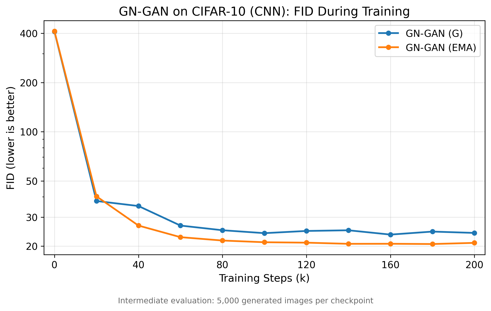
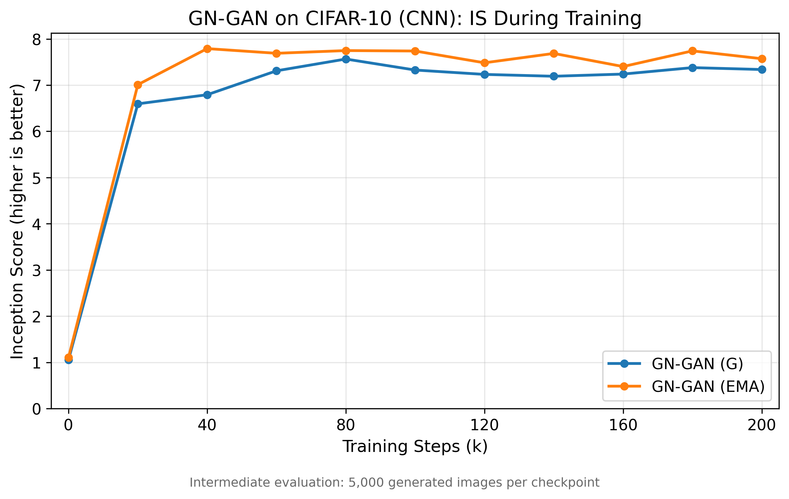
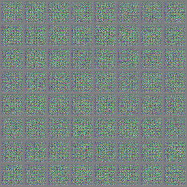
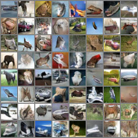
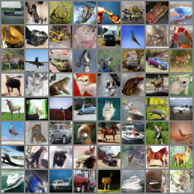
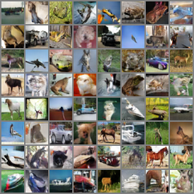

# GN-GAN Reproduction — CIFAR-10 (CNN)

This directory contains our reproduction of the GN-GAN
experiment on CIFAR-10 using the standard CNN architecture
from Wu et al., ICCV 2021.

**Contributor:** [Jialin Zhao](https://github.com/zhaojlin)

**Scope:** CIFAR-10, standard CNN (`dcgan.32`), GN-GAN only.

## 1. Experimental Setup

| Setting | Value |
|---|---|
| Dataset | CIFAR-10 (32×32) |
| Architecture | Standard CNN (`dcgan.32`) |
| Method | Gradient Normalization (GN-GAN) |
| Loss | BCE / Non-saturating GAN |
| Training steps | 200,000 |
| Batch size (D / G) | 64 / 128 |
| Learning rate (D / G) | 0.0002 / 0.0002 |
| Discriminator updates per step | 1 |
| EMA decay | 0.9999 |
| GPU | NVIDIA RTX A6000 |
| Python | 3.9.23 |
| PyTorch | 1.8.1+cu111 |
| Torchvision | 0.9.1+cu111 |

We use the original GN-GAN training implementation and
CNN configuration.

To reduce evaluation overhead, intermediate evaluations
are performed every 20,000 steps using 5,000 generated
images. Training hyperparameters remain unchanged.

## 2. Reproduction Results

All reproduced results are obtained from a single
200,000-step training run.

| Model | Step | IS ↑ | FID(train) ↓ | FID(test) ↓ |
|---|---:|---:|---:|---:|
| Paper GN-GAN | 200k | 7.71 ± 0.14 | 19.31 ± 0.76 | 23.52 ± 0.80 |
| Ours — Best G | 160k | 7.5558 | 19.1991 | 23.0810 |
| Ours — Final G | 200k | 7.5158 | 19.4485 | 23.3293 |
| Ours — Final EMA | 200k | **7.8877** | **16.2115** | **20.1145** |

### Evaluation Protocol

- IS: 50,000 generated images.
- FID(train): 50,000 generated images.
- FID(test): 10,000 generated images.
- Best G: checkpoint selected during training at step 160,000.
- Final G: regular generator at step 200,000.
- Final EMA: exponential moving average generator at step 200,000.

The paper values are reported over five runs with
different random seeds. Our reproduction uses one run.

Checkpoint selection and metric implementations are not
fully identical to the paper protocol, so the results
should be interpreted as an approximate reproduction
rather than an exact replication.

### Observations

- The reproduced GN-GAN achieves results close to the
  original paper on CIFAR-10 with the standard CNN.
- The best regular generator achieves FID(train) = 19.1991,
  compared with 19.31 reported in the paper.
- The final EMA generator achieves the best results in our
  experiment: IS = 7.8877, FID(train) = 16.2115, and
  FID(test) = 20.1145.
- EMA is part of the original implementation, not a new
  modification proposed by our team.

## 3. Training Curves

The following figures show IS and FID during training.

Intermediate evaluations use 5,000 generated images per
checkpoint. These values should not be directly compared
with the final 50,000-image evaluation.

### FID During Training



### Inception Score During Training



## 4. Generated Samples

The following images were saved during training using
the original training script.

| Step 1 | Step 20,000 |
|---|---|
|  |  |

| Step 100,000 | Step 200,000 |
|---|---|
|  |  |

These are training snapshots and should not be interpreted
as EMA-generated samples.

## 5. Reproduction Files

| File | Description |
|---|---|
| `../../config/GN-GAN_CIFAR10_CNN_Reproduction.txt` | Training configuration |
| `../../eval_reproduction.py` | Evaluation of G and EMA checkpoints |
| `results.csv` | Final evaluation results |
| `plot_curves.py` | Training curve visualization |
| `fid_curve.png` | FID training curve |
| `is_curve.png` | IS training curve |
| `samples/` | Generated training samples |

Model checkpoints and full training logs are stored
locally on the training server and are not included
in this repository.

## 6. Reproduction Commands

Run from the repository root.

### Training

```bash
CUDA_VISIBLE_DEVICES=0 python -u train.py \
  --flagfile=./config/GN-GAN_CIFAR10_CNN_Reproduction.txt \
  --num_workers=4
```

### Evaluation

Example: final EMA generator, 50,000 generated images.

```bash
CUDA_VISIBLE_DEVICES=0 python eval_reproduction.py \
  --flagfile=./config/GN-GAN_CIFAR10_CNN_Reproduction.txt \
  --checkpoint_path=./logs/GN-GAN_CIFAR10_CNN_Reproduction_v2/200000.pt \
  --weights=ema_G \
  --num_images=50000
```

For FID(test) under the 10,000-image evaluation
setting, change `--num_images` to `10000`.

For the regular generator, use `--weights=net_G`.

## 7. References

- Wu et al., *Gradient Normalization for Generative
  Adversarial Networks*, ICCV 2021.
  https://openaccess.thecvf.com/content/ICCV2021/papers/Wu_Gradient_Normalization_for_Generative_Adversarial_Networks_ICCV_2021_paper.pdf

- Official implementation:
  https://github.com/basiclab/GNGAN-PyTorch
